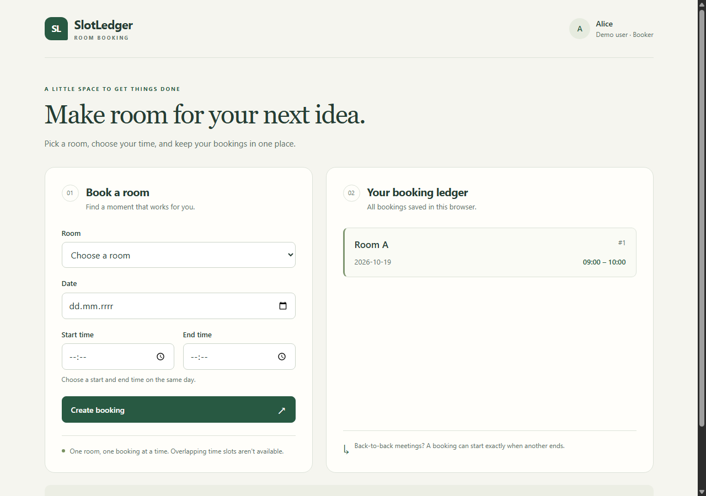

# SlotLedger

[](https://github.com/MattZurr/slotledger-qa-automation/actions/workflows/ci-pages.yml)

**Room-booking demo and QA Automation portfolio** built with TypeScript, Vitest, Playwright and GitHub Actions. SlotLedger prevents conflicting reservations and preserves bookings after a page refresh.

The project demonstrates business-rule validation, browser regression tests, controlled storage-failure scenarios and CI checks before deployment.

**Explore:** [Live demo](https://mattzurr.github.io/slotledger-qa-automation/) · [Browser tests](e2e/booking.spec.ts) · [Validation tests](src/validation/bookingValidator.test.ts) · [Storage tests](src/storage/bookingStorage.test.ts) · [Verified CI run](https://github.com/MattZurr/slotledger-qa-automation/actions/runs/39402612082) · [QA assessment](docs/QA_RELEASE_CHECK.md)

**Verified CI:** 93/93 Vitest tests, 12/12 Chromium tests and production build passed at commit `23317a8` on 2026-10-20. The run also uploaded the Playwright report and deployed the demo to GitHub Pages.

**Try it:** [Open SlotLedger](https://mattzurr.github.io/slotledger-qa-automation/) — no installation or sign-in required. Creation, persistence after refresh, overlap rejection and adjacent bookings were checked on the hosted site on 2026-10-20.

## What you can do

- Choose Room A or Room B, a date and a start/end time to create a booking.
- See your saved bookings, including after refreshing the page.
- Get a clear message if the room is already booked or the time is invalid.
- Book consecutive meetings: one booking can start exactly when another ends.

The demo uses a sample user, Alice. No sign-in is required. Bookings stay in your browser and are not shared with other people or devices.



### Try the main flow

1. Create a Room A booking for `09:00–10:00` on any valid date.
2. Refresh the page: the booking remains visible.
3. Try Room A on the same date at `09:30–10:30`: the overlap is rejected.
4. Try `10:00–11:00`: the adjacent booking is accepted.

### Inspect the automated tests

Open the [verified CI run](https://github.com/MattZurr/slotledger-qa-automation/actions/runs/39402612082) → **Test and build** → **Run Playwright tests** for the scenario results. The [test source](e2e/booking.spec.ts) shows the browser actions and assertions.

For an interactive report, download `playwright-report` from a run's **Artifacts**, extract it, then use `npx playwright show-report "<report-directory>"` from a local checkout with dependencies installed. GitHub requires sign-in to download artifacts; reports expire after seven days. The command expects the folder containing `index.html`, not the file itself.

## Run locally

Use **Node.js 22.x, version 22.12 or newer**, with npm, matching the supported range of the locked tooling. Run the following commands from the project directory.

```bash
npm ci
npm run dev
```

Open the local URL printed by Vite. No backend or environment variables are required.

```bash
npm run test:run  # Run all Vitest tests once
npm run test      # Watch mode during development
npm run build    # TypeScript check, then Vite build into dist/
npm run preview  # Serve an existing build locally
```

### Watch browser tests

After `npm ci`, install the Chromium browser and open Playwright UI:

```bash
npx playwright install chromium
npm run test:e2e:ui
```

Select a test in the UI and run it to inspect its actions and assertions. Playwright starts the local application automatically on port `4173` by default. Two runners must use different ports; results and HTML reports are separated by port.

```bash
npm run test:e2e                                      # Run once with UI stopped
npm run test:e2e:report -- playwright-report/4173      # Open the default-port report
```

To run tests alongside an open UI, use a second PowerShell terminal:

```powershell
$env:PLAYWRIGHT_PORT = "4174"
npm.cmd run test:e2e
npm.cmd run test:e2e:report -- playwright-report/4174
```

The variable applies to that terminal and its child processes. Use `Remove-Item Env:PLAYWRIGHT_PORT` to return to the default. On bash/zsh, run `PLAYWRIGHT_PORT=4174 npm run test:e2e`. Results are stored under `test-results/<port>/` and reports under `playwright-report/<port>/`; both are ignored by Git.

On Windows PowerShell, use `npm.cmd` and `npx.cmd` if arguments are not forwarded correctly. These commands require a local project checkout; the hosted application alone cannot run this suite.

### CI and deployment

The [workflow](.github/workflows/ci-pages.yml) is configured for pushes to main, pull requests and manual runs. It uses Node.js 22 and runs npm ci, Vitest, the production build, Chromium installation and Playwright. E2E uses one worker, rejects test.only and has a five-minute limit. Tests target a local Vite development server, not the production build or hosted website.

The HTML report is configured for upload after success or failure unless the run is cancelled, with seven-day retention. Failed-test traces are retained when produced. Successful upload was verified in run 39402612082; upload after failure remains unexercised in CI.

Tests and build run independently of deployment. Pages artifact upload and deployment require the repository Actions variable `PAGES_ENABLED` to equal `true`, a main push or manual main run, and successful verification. An unset variable leaves deployment disabled. PRs do not deploy. This repository uses GitHub Actions as the Pages source.

## QA approach and evidence

Tests focus on business boundaries and data consistency. Vitest exercises individual validators and their use in booking creation/storage loading, with mocked storage and a controlled clock for timestamp assertions. Playwright exercises the browser UI and real browser-local storage; read/write exceptions are deliberately simulated.

The application also validates real calendar dates, booking permissions and data loaded from `localStorage`, including identifiers and duplicate booking IDs. Stored bookings use the key `slotledger.bookings`. A failed initial read prevents new bookings; a failed save does not add an unsaved booking to the list.

| Business rule | Risk | Existing test evidence |
| --- | --- | --- |
| A room cannot have overlapping bookings on the same date | Double booking | [Vitest validation tests](src/validation/bookingValidator.test.ts): partial overlap, containment, identical ranges, touching boundaries, different rooms/dates |
| Times must use `HH:mm`, with end after start on the same day | Invalid duration or incorrect time comparisons | [Vitest validation tests](src/validation/bookingValidator.test.ts): malformed/out-of-range times, equal/reversed times, midnight crossing and minute boundaries |
| Dates must use `YYYY-MM-DD` and exist in the calendar | Impossible dates entering the booking list | [Vitest validation tests](src/validation/bookingValidator.test.ts): format, whitespace, month/day limits, leap years including 1900/2000, and `INVALID_DATE` from creation |
| Only a booker may create a booking, and the room must exist | Disallowed booking creation or invalid room reference | [Vitest validation tests](src/validation/bookingValidator.test.ts): viewer rejection, missing room and empty room catalog |
| Booking creation assigns identity/timestamp without changing its input list | Incorrect metadata or accidental state mutation | [Vitest creation tests](src/validation/bookingValidator.test.ts): empty/unsorted/gapped IDs, current user ID, fixed timestamp and unchanged input list |
| Loaded data must satisfy the application's format and identity assumptions | Corrupted state or missed collisions | [Vitest storage tests](src/storage/bookingStorage.test.ts): structural/semantic rejection, positive safe integer IDs and duplicate booking IDs |
| Invalid stored data must be preserved and access failures reported | Silent data loss or unreported persistence failure | [Vitest storage tests](src/storage/bookingStorage.test.ts): malformed JSON, no write/delete/clear on validation failure, read/write exceptions and JSON serialization |

The twelve [Chromium scenarios](e2e/booking.spec.ts) cover creation and persistence, overlap rejection, reversed/equal times, correction after invalid time, touching boundaries, independent rooms/dates, malformed stored JSON, an impossible stored date, and simulated read/write failures. Invalid-data cases check blocked creation and unchanged raw storage; the write-failure case checks preservation of the original booking. These tests do not simulate real quota exhaustion or all invalid-data cases.

### Verification status

CI evidence: [manually triggered run 39402612082](https://github.com/MattZurr/slotledger-qa-automation/actions/runs/39402612082) for commit `23317a8`, on 2026-10-20, using Ubuntu and Node.js 22.23.3. Job logs confirm dependency installation, the results below and successful report upload. Pages artifact upload and deployment also succeeded.

| Check | Verified result |
| --- | --- |
| Vitest in CI | **93/93 passed**, validation/creation and storage |
| Playwright in CI | **12/12 passed**, Chromium, one worker |
| Production build in CI | **Passed**, TypeScript and Vite |
| Local verification | **93/93 Vitest** on 2026-10-16; **12/12 Chromium and build** on 2026-10-17, Windows / Node.js 22.14.0 |
| Hosted demo | **Passed** on 2026-10-20: deployment and separate Chromium smoke check |

The [QA Release Check](docs/QA_RELEASE_CHECK.md) records three core risks and evidence gaps. The maintained E2E suite targets the local Vite development server. A separate smoke check on the hosted demo verified create → display → refresh → persists, overlap rejection and adjacent bookings in an isolated Chromium context. The page, JavaScript, CSS and favicon returned HTTP 200, with no browser console errors or uncaught page errors during this check.

### Defect example: stored time format

An audit found that structural storage validation accepted `9:00`, while overlap logic relied on fixed-width `HH:mm` comparisons. That mismatch could allow a collision to be missed. The loader now reuses `timeValidation()` and rejects the invalid stored value. The [storage regression tests](src/storage/bookingStorage.test.ts) protect that contract; the complete browser collision scenario is not automated.

## Stack and architecture

TypeScript 6, Vite 8, Vitest 5, Playwright, HTML/CSS and browser `localStorage`. No application framework or backend.

| Location | Responsibility |
| --- | --- |
| [`src/models/`](src/models/) | Booking, room and user types; explicit success/failure result unions |
| [`src/validation/bookingValidator.ts`](src/validation/bookingValidator.ts) | Business validators and booking creation |
| [`src/storage/bookingStorage.ts`](src/storage/bookingStorage.ts) | Runtime validation, JSON loading and full-list saving |
| [`src/main.ts`](src/main.ts) | Demo data, DOM rendering, startup loading and form orchestration |
| [`src/style.css`](src/style.css) | Responsive layout and visual states |

The submit flow is **form → `createBooking()` → `saveBookings()` → update state and render**. Business validation returns explicit error codes rather than handling UI messages or persistence. On load, runtime checks protect business assumptions that TypeScript types alone cannot enforce on stored JSON.

The build runs the TypeScript compiler before Vite. Effective strict options were checked through the locked TypeScript 6.0.3 compiler API and are enabled.

## Current limitations

- Educational, single-browser demo: no authentication, backend, shared availability or synchronization across devices/tabs. The role rule is application logic, not a security boundary.
- Fixed demo user and room catalog; no role switch, booking edit/delete or room management.
- Same-day bookings only. Past dates are permitted; a future-only policy or booking horizon has not been defined.
- Storage validation checks individual records and booking-ID uniqueness. It does not re-check all stored overlaps, current room membership or timestamp semantics.
- Vitest covers business logic and mocked storage. Browser automation covers Chromium only; semantic-storage coverage is limited to one impossible date, and actual storage limits remain untested.
- npm ci reported one high-severity dependency finding during local verification. The lockfile still includes the previously flagged source-map-js 1.2.1 development dependency; no fix was applied. The app has no user source-map processing feature.

### Development approach

I built SlotLedger as a hands-on QA automation project, using AI as a supporting tool throughout development.

- My implementation: I developed the TypeScript booking logic, wrote Vitest unit tests and Playwright E2E scenarios, and worked through implementation and debugging challenges. I used AI for technical explanations, code examples, additional test ideas and feedback when needed.
- AI-generated components: The HTML/CSS interface and visual assets were generated by AI.
- Shared implementation: I worked with AI assistance on project tooling, GitHub Actions CI configuration and documentation.
- My QA approach: I identified risks, designed test scenarios, defined expected results and evaluated release readiness. For example, I tested how the application handles corrupted localStorage data, ensuring that invalid records prevent new bookings without silently overwriting existing data.
